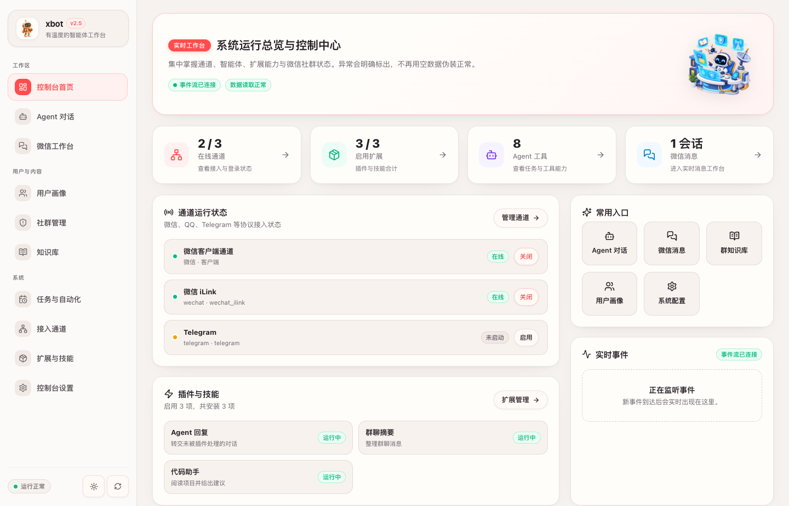
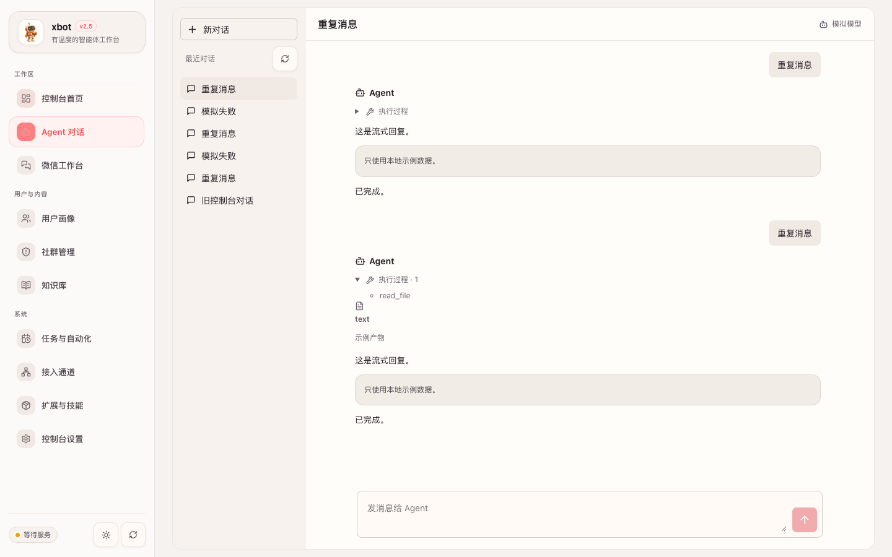
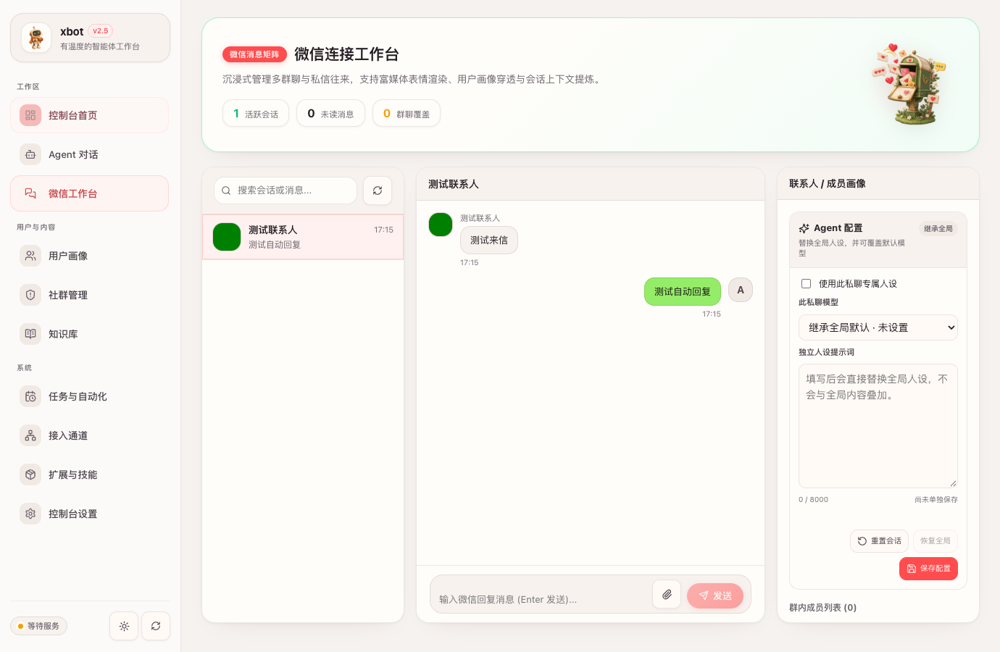

# xbot-next

**自托管的 Agent 与消息机器人工作台。** 在一个 Web 控制台里和 Hermes Agent 对话、管理微信会话，并配置自动化任务。

[桌面预览](#桌面预览) · [快速开始](#快速开始) · [模型与通道](#模型与通道) · [开发指南](#开发指南) · [许可](#许可)



## 桌面预览

下图来自实际桌面 Web 界面，使用演示账号和消息。

### Agent 对话

从左侧切换会话，在主区查看流式回复、工具执行记录和产物。Web 对话独立于微信会话，默认不会向外部通道回发。



### 微信工作台

集中查看私聊、群聊和消息历史。微信客户端通道支持同步联系人及可用头像；来信显示在左侧，机器人已发送的回复显示在右侧。



控制台还提供通道状态、定时任务、插件和 Skill 管理；Agent 需要外部工具时，可按需接入 MCP。

## 快速开始

| 你的目标 | 推荐方式 |
| --- | --- |
| 在服务器上长期运行一个新实例 | [Docker 独立部署](#docker-独立部署)，PostgreSQL + Redis |
| 在个人电脑上先试用 | [本地安装](#本地安装)，可选 SQLite + 本地队列 |
| 修改后端或 Web 控制台 | [开发指南](#开发指南)，从锁文件安装依赖 |

### Docker 独立部署

1. 按 [Docker 部署指南](docs/docker-deployment.md) 构建并加载镜像。部署端不需要同步源码。
2. 准备独立的 `.env`，设置 `XBOT_IMAGE`、新的 `XBOT_API_TOKEN` 和 `XBOT_POSTGRES_PASSWORD`，再执行 `docker compose up -d`。
3. 打开 `http://127.0.0.1:18548`，输入 API Token。默认只监听回环地址，不要直接把控制台暴露到公网。

> [!IMPORTANT]
> 新版只支持空库初始化，不能直接连接旧实例的数据库或复用旧数据目录。备份时同时保留 `.env`、`state/`、PostgreSQL 和 Redis 持久化数据；不要随容器删除数据卷。

### 本地安装

先准备 Git 和 [uv](https://docs.astral.sh/uv/)。下载仓库中的对应安装脚本后在本机运行；安装器会检出代码、创建 `xbot` 命令并启动配置向导。已有安装请用 `xbot-upgrade`，不要重新运行安装脚本，也不要用升级脚本将旧实例切到这套空库版本。

```bash
# Linux、macOS、WSL
bash scripts/install.sh
```

```powershell
# Windows PowerShell
& .\scripts\install.ps1
```

在 `xbot setup` 中可选「简易版」（SQLite + 本地队列）。`xbot` 启动终端对话，`xbot run` 启动服务。需要 Web 控制台时先运行 `xbot ui-build`；通过本机 `http://127.0.0.1:8548` 访问。

## 模型与通道

先在 **控制台设置 → 系统与模型配置** 设置服务地址、模型名和 API Key，再到 **Agent 对话** 试发一条消息。不接微信也能使用 Web Agent。支持 OpenAI-compatible 和 Anthropic 接口；环境变量和权限边界见 [Hermes 集成指南](docs/hermes-agent-integration.md) 与 [.env.example](.env.example)。真实密钥只存于本机配置或部署环境。

需要收发微信消息时，再到 **接入通道** 配置 **微信客户端通道** 或 **微信 iLink**。微信客户端通道仍使用 `XBOT_WECHAT869_*` 配置键，依赖单独运行的微信客户端服务。

## 开发指南

需要 [uv](https://docs.astral.sh/uv/)、Python 3.14，以及构建 Web 界面时使用的 Node.js/npm。在项目根目录执行：

```bash
uv run --no-project --python 3.14 python scripts/prepare_hermes.py
uv sync --locked --python 3.14 --extra agent --extra dev
uv run --no-sync xbot setup
uv run --no-sync xbot ui-build
uv run --no-sync xbot run
```

Web 源码在 [`ui/`](ui/)，Python 后端在 [`src/xbot/`](src/xbot/)，扩展入口在 [`plugins/`](plugins/) 和 [`skills/`](skills/)。前端单独开发可运行 `npm --prefix ui ci` 和 `npm --prefix ui run dev`。

```bash
uv run --no-sync ruff check src tests scripts
uv run --no-sync pytest -q
npm --prefix ui run build
```

[后端设计](docs/backend-framework-design.md) · [Web 控制台设计](docs/frontend-control-ui.md) · [Hermes 集成](docs/hermes-agent-integration.md) · [Docker 部署](docs/docker-deployment.md)

## 许可

本项目采用 [源码开放的非商业许可](LICENSE)，允许学习、研究、个人非商业使用、修改和非商业分发。未经书面授权不得商用。这不是 OSI 定义下的开源许可证。
